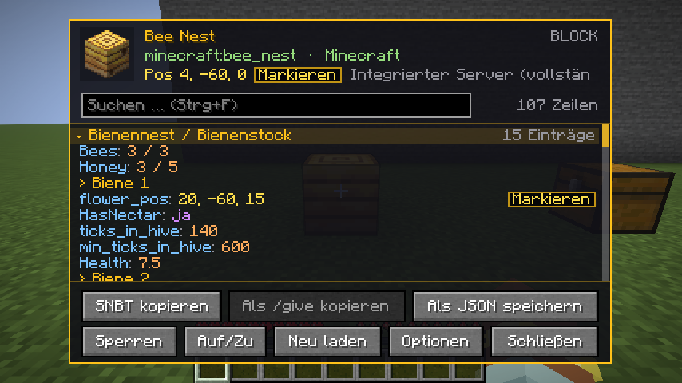
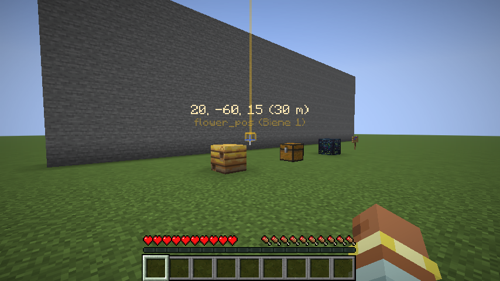
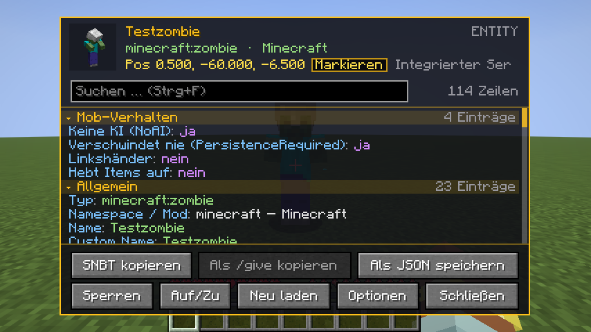
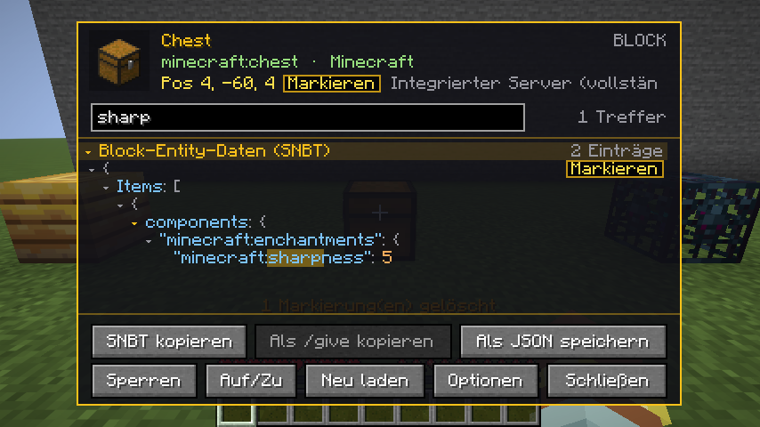

<p align="center">
  
</p>

# InspectAll

    

**Minecraft 1.21.11 · Fabric · Java 21 · nur Client** · von **redstone_nugget**

Drück **H** und sieh alles, was Minecraft über einen Block, ein Item oder eine Entity weiß: Blockstate,
Eigenschaften, Umgebung, Datenkomponenten, Block-Entity- und Entity-NBT (SNBT mit Hervorhebung und
einklappbaren Abschnitten), lesbare Zusammenfassungen für bekannte Blöcke, Koordinaten-Markierungen durch
Wände, Suche, Kopieren und JSON-Export.

<p align="center">
  
  
</p>
<p align="center">
  
  
</p>

> **English:** Press **H** to see everything Minecraft knows about a block, item or entity: block state,
> properties, data components, block entity and entity NBT (highlighted, collapsible SNBT), readable summaries,
> coordinate markers visible through walls, search, copy and JSON export. Client-side only, works on any server
> (shows what the server sends; full data in singleplayer or with OP). German and English included.

> **Nur Client, kein Server nötig.** Die Mod registriert keine Blöcke oder Items, sendet keine eigenen
> Netzwerkpakete und verändert die Welt nie.

## Download

[**Modrinth**](https://modrinth.com/mod/inspectall) oder [**GitHub Releases**](https://github.com/RedstoneNugget/InspectAll/releases).

## Installation

1. [Fabric Loader](https://fabricmc.net/use/) (≥ 0.19) für Minecraft 1.21.11 installieren.
2. [Fabric API](https://modrinth.com/mod/fabric-api) in den `mods`-Ordner legen.
3. `inspectall-1.0.0.jar` in den `mods`-Ordner legen.
4. Optional: [Mod Menu](https://modrinth.com/mod/modmenu), dann sind die Einstellungen auch über die Mod-Liste erreichbar.

## Bedienung
| Taste | Funktion |
|---|---|
| **H** | Info-Panel für das aktuelle Ziel öffnen bzw. schließen |
| **G** | Ziel sperren/entsperren. Gesperrt bleibt das Panel als Overlay offen, während du spielst. H öffnet dann immer das gesperrte Ziel. |
| **J** | Alle Markierungen in der Welt löschen |

Alle Tasten lassen sich unter *Optionen → Steuerung → Tastenbelegung → InspectAll* ändern.

**Ziel:** In Inventar- und Container-Screens das Item unter dem Mauszeiger, sonst die angesehene
Entity, dann der angesehene Block (Fadenkreuz, notfalls mit bis zu 64 Blöcken Reichweite), zuletzt das
Item in der Haupt- bzw. Nebenhand.

**Im Panel:**
- Mausrad scrollt, Shift + Mausrad scrollt seitlich. Pfeiltasten, Bild↑/↓, Pos1 und Ende gehen auch.
- Strg+F oder ein Klick ins Suchfeld filtert alle Zeilen. Treffer im SNBT werden mit ihren Eltern-Knoten angezeigt.
- Ein Klick auf eine Abschnittsüberschrift oder eine `{`/`[`-Zeile klappt sie ein oder aus. „Auf/Zu“ wirkt auf alles.
- „Markieren“ an Koordinaten (`flower_pos`, `hive_pos`, `pos`, Int-Arrays mit 3 Werten, X/Y/Z …) zeigt in der
  Welt einen durch Wände sichtbaren Umriss mit Strahl und der Beschriftung „X, Y, Z (Distanz m)“.
- „SNBT kopieren“, „Als /give kopieren“ (bei Items) und „Als JSON speichern“. Die JSON-Datei landet in
  `<Spielordner>/inspectall/exports/`.
- „Neu laden“ liest das Ziel neu ein. „Optionen“ öffnet die Einstellungen.

## Was auf Servern sichtbar ist
- **Singleplayer:** Blöcke und Entities werden zusätzlich über den integrierten Server gelesen, also vollständig.
- **Mehrspieler:** Angezeigt wird nur, was der Server an den Client schickt. Für Block-Entities ermittelt der
  Mod, welche Felder Vanilla überträgt. Alles andere (z. B. Truhen-Inhalte, Bienen im Nest, Befehle in
  Kommandoblöcken, Effekte und Befehls-Tags fremder Entities) steht als **„Vom Server nicht übertragen“** im Panel.
- **Mehrspieler mit OP-Rechten:** Der Mod holt die vollen NBT über die Vanilla-Abfrage, die auch F3+I nutzt.
  Das lässt sich in den Einstellungen abschalten („OP: Server-NBT abfragen“).
- **Items** sind immer vollständig, weil der Server alle Komponenten an den Client schickt.

## Einstellungen
Über „Optionen“ im Panel (oder Mod Menu), gespeichert in `config/inspectall.json`:
Panel-Position (links/Mitte/rechts), Breite, Deckkraft, alle Farben (`#RRGGBB`), sichtbare Kategorien,
Tooltip-Hinweis „H: alle Daten“, Overlay bei Sperre, Reichweite, max. SNBT-Zeilen, OP-Abfrage.

## Entwicklung

Benötigt JDK 21.

```
gradlew build              → build/libs/inspectall-1.0.0.jar
gradlew runClient          → Spiel mit Mod starten
gradlew runClientGameTest  → automatischer In-Game-Test (Singleplayer + dedizierter Server) mit Screenshots
```

Eine neue Version erscheint automatisch, sobald ein Tag wie `v1.0.1` hochgeladen wird: GitHub baut die Mod,
erstellt ein Release und lädt die `.jar` auf Modrinth hoch (Text aus `.github/release-notes.md`).

## Lizenz

[MIT](LICENSE) © 2026 redstone_nugget
